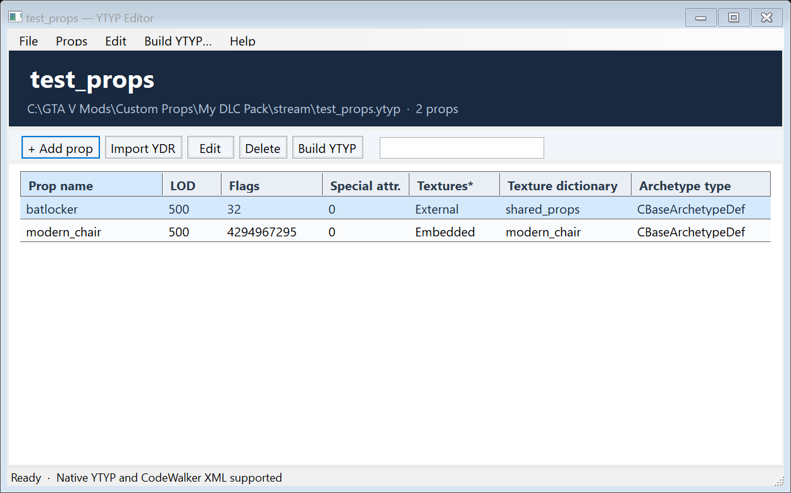
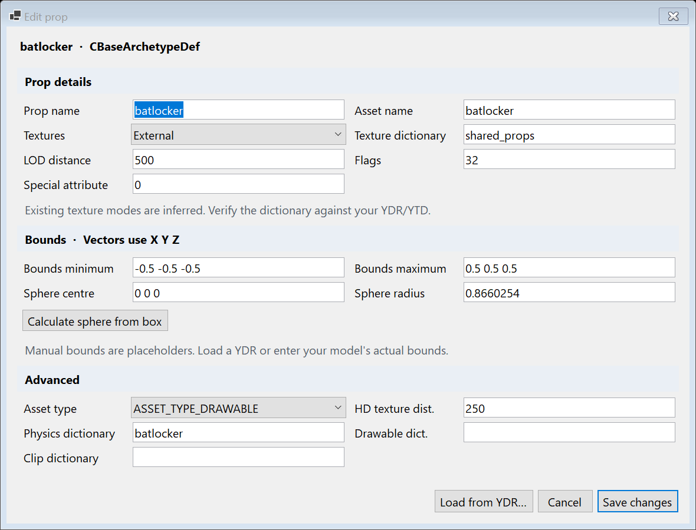

# GTA V YTYP Editor

Windows editor for GTA V prop archetypes. Open existing native `.ytyp` or CodeWalker XML, add/edit props, and build a native game-format YTYP.

## Run

Extract the Windows release ZIP, then run **YtypEditor.exe**. Windows 10/11, x64. No .NET installation is required.

[Download the latest Windows release](https://github.com/Exodus2597/gta-v-ytyp-editor/releases/latest).

The release folder contains the executable, a short guide, and a `licenses` folder. Runtime libraries are bundled inside the executable; tests, screenshots, source, build caches, and unused CodeWalker content files are excluded. .NET extracts its native libraries into its per-user temporary cache on first launch.

## Features

- Open/create native YTYP and CodeWalker XML.
- Add, edit, duplicate, delete, search, and import/export prop JSON.
- One prop form with details, bounds, and advanced fields.
- External/Embedded texture setup, raw unsigned flags, special attributes, dictionary references, and asset types.
- Import bounds and texture/collision hints from Legacy YDR or Drawable XML.
- Undo/redo, unsaved-change prompts, atomic saves, and a `.bak` backup on overwrite.
- Build verification reloads native output and checks source fields for data loss.
- Preserve specialised time/MLO content, dependencies, extensions, and composite types supported by CodeWalker.

See [user guide](docs/USER_GUIDE.md) for the workflow and limitations.





## Build and test

Requires Windows, Git, .NET SDK 10, and internet access for the initial dependency/package download.

```powershell
./scripts/build.ps1 -Test
```

The script downloads CodeWalker at commit `485d56bec00262ed7fa472261cce7bbc6202b96e` into ignored `vendor/CodeWalker`, builds a self-contained single-file executable, runs 40 checks, and writes a ZIP and SHA-256 file under ignored `artifacts/`.

To reuse a matching CodeWalker checkout without downloading it:

```powershell
./scripts/build.ps1 -Test -CodeWalkerPath C:/path/to/CodeWalker
```

Source layout:

```text
src/YtypEditor/       Application and existing self-tests
scripts/build.ps1    Dependency setup, build, verification, packaging
.github/workflows/   Windows build/test workflow
docs/                Guide, release notes, publishing preparation
licenses/            Upstream notices and terms
```

The repository excludes dependency source, binaries, test fixtures, and temporary build files. GitHub Actions builds and uploads artifacts; it does not create or publish releases.

## Validation

Existing checks cover native open/edit/add/build/reopen, readable names after clearing the hash index, uint limits, XML/JSON round trips, backups, invalid input, specialised data preservation, model import, and rendering at normal and smaller window sizes. In-game GTA V testing and tests against user-supplied YTYPs remain outstanding.

## Licence and credits

The editor's original source is licensed under [MIT](LICENSE).

CodeWalker source is downloaded separately for building; the executable embeds CodeWalker Core. CodeWalker, SharpDX, and the .NET runtime retain their own terms and notices. The editor's MIT licence does not relicense those dependencies.

See [release instructions](docs/PUBLISHING.md) and the unchanged dependency notices in [licenses](licenses/).
